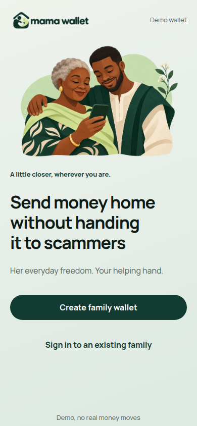
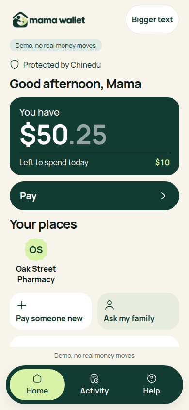
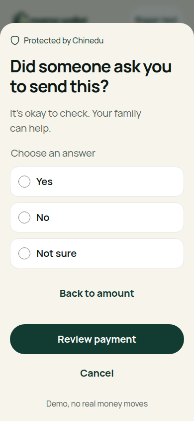
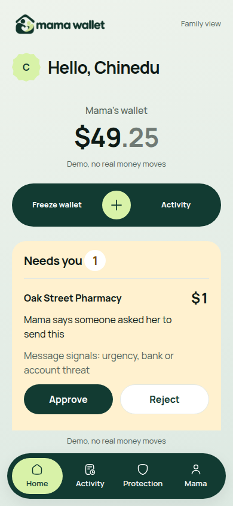

# Ward + Mama Wallet

**Send money home without handing it to scammers.**

A caller pretends to be Mama’s bank and tells her to move her money to a “safe account.”
Her family can send money home and set rules about how much she can spend and when to ask them first.
Ward checks payments against those rules; Mama Wallet is the family-facing app.

Built for NEAR HACKATHON: **Security · Real-World Money · Social Money**.

<table><tr>
<td></td>
<td></td>
<td></td>
<td></td>
</tr></table>

## Implementation and verification status

| Component | Honest status |
| --- | --- |
| Mama Wallet — NEAR testnet USDC mode | **Verified end to end by the project owner:** sent testnet USDC to another recipient through the app. Uses on-chain token balances and signed transactions. |
| Policy engine | 39 JavaScript tests; runs offline after installation. |
| Mama Wallet — offline demo mode | Local mock ledger and demo dollars for credential-free evaluation. The scripted bank-scam test exercises a pressure hold and family rejection. |
| NEAR vault | Verified in the signed local Sandbox test, including token settlement; public testnet receipts below show 3 test NEAR settled. |
| NEAR Intents | Dry quotes only; adapter tested with simulated HTTP responses. Live quotes and delivery to the vault **UNVERIFIED**. |
| NEAR AI Cloud screening | Optional adapter, tested with simulated responses. Live inference and TEE attestation **UNVERIFIED**. |

## Try it in 2 minutes

Use **Node.js 22.23.4+** (verified on 22.23.4 and 24.22.1). From the repository root:

```sh
npm install
npm test
npm run --silent demo:bank-scam
```

The tests pass. The scripted bank-scam test scenario uses a separate in-memory ledger and prints:

```text
SCRIPTED BANK SCAM | Pay now or your account will be frozen. Do not call your family.
HOLD | someone_asked | Mama says someone asked her to send this
FAMILY INBOX | new payee | Bank safe account | safe-account.test
NEW PAYEE | rejected
AUDIT
HOLD | someone_asked | Mama says someone asked her to send this
ACTIVITY | payee_requested | Mama asked to add a new place
ACTIVITY | payee_rejected | Family rejected a new place
```

```sh
npm run dev
```

Open [http://127.0.0.1:4173/family](http://127.0.0.1:4173/family). This starts the offline demo mode, which needs no credentials or Rust toolchain.
For blockchain-backed operation, follow the [NEAR testnet USDC setup](docs/testnet-usdc-app.md).

1. **Create family:** enter Chinedu and Mama, keep limits 10 / 3 / 1, and add Oak Street Pharmacy (`pharmacy.test`) as an approved place.
2. **Pair Mama:** generate a pairing link and open it in a separate browser profile on the same computer; accept the invitation.
3. **Send money:** in Family, send 50.25 using USDC on Base, preview the fixture quote, and confirm the demo transfer.
4. **Pressure payment held:** in Elder, pay the pharmacy 1, answer **Not sure**, enter “Pay now. Your account will be frozen.”, review, and confirm. Family sees **Needs you · 1**.
5. **Approve or reject:** resolve the held payment in Family. Approval sends it; rejection stops it without debiting the balance.

[Full 11-step PWA walkthrough and recording seed](docs/pwa-walkthrough.md) · [Playwright QA and screenshots](docs/qa.md)

## How the rules apply

| Rule | Standalone CLI / vault | Mama Wallet offline demo mode |
| --- | --- | --- |
| Daily cap and per-payment ceiling | Hard checks; approval rechecks hard rules. | Balance and spending checks in the local ledger. |
| Payee allowlist | Enforced in standalone CLI demos and standalone vault. | **Not enforced:** any valid recipient within the spending rules; saved places are shortcuts. |
| Approval threshold | Above threshold becomes `HOLD`; family approval required. | Same threshold hold and family review. |
| UTC spending windows | Up to eight windows; empty list allows any time. | Defaults to no spending windows; daily cap resets at UTC midnight. |
| Note screening | CLI screens after hard checks; vault hard rules are independent. | Best-effort screening; **Yes** / **Not sure** adds an app-layer hold after hard rules pass. |

```text
Family
  |
  v
Mama Wallet
  -> Ward check
       -> (mock ledger | NEAR vault)
```

[Architecture, storage, replay, privacy and CLI examples](docs/architecture.md) · [Local Sandbox proof](docs/sandbox-proof.md)

## Verify on NEAR testnet

The standalone vault is deployed at [`vault.aftersnow.testnet`](https://testnet.nearblocks.io/address/vault.aftersnow.testnet).
Finalized receipts show two payments totaling **3 test NEAR**.
The current on-chain key list for `elder.aftersnow.testnet` contains one function-call key scoped to `request_payment` on this vault.

| Step | Verified result | Transaction |
| --- | --- | --- |
| Deploy and initialize | Deployed the contract and called `new` | [`5PrMF7WGDzutKDbENu7g2n2kA7TtNwUVTe2Puxf39CQx`](https://testnet.nearblocks.io/txns/5PrMF7WGDzutKDbENu7g2n2kA7TtNwUVTe2Puxf39CQx) |
| Rotate elder key | Added the scoped key and removed the original full-access key | [`DygFdzwWK1tQ1ikDXsqhVgbhQcQXhA8X4yaoGqZsvRvL`](https://testnet.nearblocks.io/txns/DygFdzwWK1tQ1ikDXsqhVgbhQcQXhA8X4yaoGqZsvRvL) |
| Request 1 test NEAR | `ALLOW` and `SETTLED` for request 1 | [`VBjpEYCL4THDxuZv8XyHKSBPqykPN8ApGh1GDyMg74s`](https://testnet.nearblocks.io/txns/VBjpEYCL4THDxuZv8XyHKSBPqykPN8ApGh1GDyMg74s) |
| Request 2 test NEAR | `HOLD` for request 2 under `approval_threshold` | [`DcUyxSGL366nRaZKoTe6kuiNk9PcMS9SJ1Mf59GG2AvM`](https://testnet.nearblocks.io/txns/DcUyxSGL366nRaZKoTe6kuiNk9PcMS9SJ1Mf59GG2AvM) |
| Approve as family | `ALLOW` and `SETTLED` for request 2 | [`BHa6LtkiTDQH8VPhrUoR9pM9FgyXLVPhgNJzJzJg9aPW`](https://testnet.nearblocks.io/txns/BHa6LtkiTDQH8VPhrUoR9pM9FgyXLVPhgNJzJzJg9aPW) |
| Request payment to an unapproved recipient | `BLOCK` under `payee_allowlist` | [`i5bEZrvefHUCFhJKYD3YqwGFBwy6XARpbu3XpxFFadv`](https://testnet.nearblocks.io/txns/i5bEZrvefHUCFhJKYD3YqwGFBwy6XARpbu3XpxFFadv) |

Inspect receipts and access-key permissions without credentials or signing.
[Reproduce: sponsor and deploy](docs/testnet-vault.md) · [Browser testnet USDC setup](docs/testnet-usdc-app.md)

## NEAR tools used

- NEAR Rust SDK **5.29.0** for the vault and mock-runtime unit tests.
- NEAR Sandbox **2.12.0** (protocol 84), NEAR Workspaces **5.0.0**, and NEAR API JS **5.1.1** for the local proof; the public testnet proof uses the same API JS version.
- NEAR Intents **1Click** dry quote adapter and optional **NEAR AI Cloud** Chat Completions adapter (`zai-org/GLM-5.1-FP8`). See [integration setup and references](docs/optional-integrations.md).

## Baseline and disclosure

- goChameleon is the team's pre-existing payment gateway. Ward is developed in a separate repository and the demo has no goChameleon dependency.
- Libraries and AI-assisted code: Node.js built-ins including `node:sqlite`, NEAR Rust SDK for the vault, NEAR Workspaces and NEAR API JS for the optional Sandbox test. Codex generated the policy, vault, ledger, funding and screening adapters, Mama Wallet, demo and tests.
- The illustrations and logo were AI-generated for this project; see [illustration and brand assets](docs/design/ILLUSTRATIONS.md).

## Limits and honesty

- Bank integration is outside the demo scope. Screening uses a small synthetic scenario set; scores are advisory and a low score offers no assurance about fraud.
- The vault spike accepts one pending payment at a time. Native NEAR transfers count at scheduling; token transfers reserve the amount and release it on confirmed failure.
- A retained vault full-access key can bypass the contract. The agent and elder receive only the scoped requester key; the family approves from a separate account.
- The published CLI vault and browser family vault are separate deployments. Mock dollars are simulated units; testnet USDC and NEAR are not redeemable dollars, even where Elder shows a dollar sign.
- Local storage is not end-to-end encrypted; the server operator can access the database. See [storage and privacy](docs/architecture.md#how-the-firewall-works).

## License

MIT. See [LICENSE](LICENSE).
